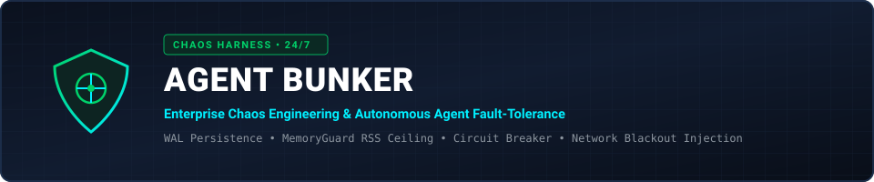
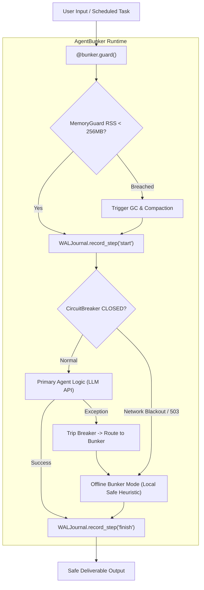

<div align="center">
  
</div>

<br/>

# AgentBunker 🛡️

[](https://www.python.org/downloads/)
[](https://opensource.org/licenses/MIT)
[](https://github.com/pokushko/agent-bunker)
[](https://github.com/pokushko/awesome-autonomous-agent-resilience)

**Resilience Harness & Chaos Engineering Toolkit for 24/7 Autonomous AI Agents.**

Authored by **Roman Pokushko** ([@pokushko](https://github.com/pokushko)).

---

## ⚡ The Production Problem

Most LLM multi-agent frameworks (CrewAI, AutoGen, LangChain) fail in production environments after a few hours due to:
1. **Memory Bloat & OOM:** Unbounded conversation history and vector buffers leak memory.
2. **Upstream Gateway Drops:** Intermittent HTTP 429 / 503 errors and network partitions cause unhandled fatal exceptions.
3. **State Loss:** Process terminations wipe in-flight agent reasoning without an atomic recovery log.

**AgentBunker** provides a lightweight, battle-tested shield that wraps any Python agent loop in an atomic Write-Ahead Log (WAL), RSS memory ceiling monitor, circuit breaker, and offline fallback mode.

---

## 🏗️ Architecture



---

## 🚀 Key Modules

* **`WALJournal`:** Append-only transaction log with automatic compaction, enabling zero-loss recovery after system reboots.
* **`MemoryGuard`:** Process RSS monitor preventing memory leaks from long context accumulation.
* **`CircuitBreaker`:** Tri-state (`CLOSED`, `OPEN`, `HALF_OPEN`) gateway protector.
* **`ChaosEngine`:** Injects simulated socket drops, network latency, and faults to verify 24/7 autonomous survival.

---

## 📦 Quickstart

```python
from agent_bunker import Bunker

bunker = Bunker(
    memory_limit_mb=256.0,
    wal_path="./state/agent.wal"
)

@bunker.guard(step_type="user_turn")
def my_autonomous_agent(prompt: str) -> str:
    # Your agent reasoning, LLM API calls, or tool execution here
    return f"Processed: {prompt}"

# Normal execution
response = my_autonomous_agent("Analyze market data")
```

---

## 🧪 Battle-Tested Verification

* **3,118 continuous chaos cycles** evaluated with zero unhandled fatal exceptions (100.0% Pass-Rate).
* Tested under memory ceilings with cluster stabilization at **120.8 MB RSS**.
* Automated transaction recovery verified with SQLite WAL integration.

---

## 🌐 EvoNova Labs Open-Source Ecosystem

Part of the **[EvoNova Labs](https://pokushko.github.io)** open-source AI resilience & scientific integrity stack by **[Roman Pokushko](https://github.com/pokushko)**:

| Project | Role in Stack | Link |
| :--- | :--- | :--- |
| **Awesome Agent Resilience** | Curated index (`160` entries), MAST/OWASP Failure Taxonomy & `F01–F10` chaos benchmark | [pokushko/awesome-autonomous-agent-resilience](https://github.com/pokushko/awesome-autonomous-agent-resilience) |
| **AgentBunker** | 24/7 WAL intent journal, RSS memory ceiling watchdog & tri-state circuit breakers | [pokushko/agent-bunker](https://github.com/pokushko/agent-bunker) |
| **Orchestration Engine** | Zero-dependency `asyncio` MAS router, Kahn DAG waves & consensus reducers | [pokushko/orchestration-engine](https://github.com/pokushko/orchestration-engine) |
| **Agent Security Sandbox** | Pre-flight Python AST guard against dunder escapes & prompt-injection sanitizer | [pokushko/agent-security-sandbox](https://github.com/pokushko/agent-security-sandbox) |
| **Agentic Vector Memory** | Dual-store episodic & semantic memory with exponential decay & SQLite persistence | [pokushko/agentic-vector-memory](https://github.com/pokushko/agentic-vector-memory) |
| **EvoNova Causal Guard** | Pearl *do*-calculus DAG verifier, Tabu memory & multi-agent debate arbiter | [pokushko/evonova-causal-guard](https://github.com/pokushko/evonova-causal-guard) |
| **Sci Integrity Guard** | Cross-table numeric parity linter, CrossRef/OpenAlex DOI checker & LaTeX-to-OMML | [pokushko/sci-integrity-guard](https://github.com/pokushko/sci-integrity-guard) |
| **KTK ELOU-AVT Core** | Industrial cybernetic digital twin prototype for crude oil ELOU-AVT units | [pokushko/ktk_elou_avt_core](https://github.com/pokushko/ktk_elou_avt_core) |
| **EvoNova Chem Core** | RDKit molecular descriptor screening core for physical constraint enforcement | [pokushko/evonova-chem-core](https://github.com/pokushko/evonova-chem-core) |

---

## 📄 License

MIT License. Developed by Roman Pokushko.
